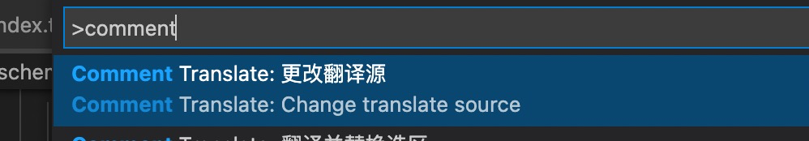
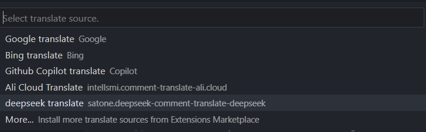

# DeepSeek 智能注释翻译插件

本插件为「Comment Translate」提供DeepSeek的翻译源支持，需配合主插件使用。

## 功能特点

1. 支持DeepSeek官方API和Ollama本地部署两种模式
2. 提供智能的代码注释翻译能力
3. 自动检测API连接状态
4. 实时显示翻译服务响应时间
5. 跟随主插件的目标语言设置，可翻译为简体中文、繁体中文、日语、英语等
6. 多行注释逐行对齐，避免整段译文因行数不匹配被主插件丢弃

## 使用要求

需先安装 [Comment Translate 插件](https://marketplace.visualstudio.com/items?itemName=intellsmi.comment-translate)

## 使用指南

1. 安装后通过命令面板调用「切换翻译源」功能
    
2. 选择「DeepSeek Translate」并配置API参数
    
3. 在代码编辑器中直接使用翻译功能（快捷键：`Ctrl+Shift+T`）

## 目标语言

翻译目标语言读取主插件的 `commentTranslate.targetLanguage` 设置，可点击状态栏切换，或用命令面板「Comment Translate: Change translate target language」修改。源语言默认自动识别。

多行注释会按行翻译，译文行数与原文严格一致——这是主插件回填译文的前提条件，行数不符会导致整段译文被丢弃。

## 配置说明

本插件提供以下配置项：

* `deepseekTranslate.authKey`: DeepSeek API认证密钥（云端API必填）
* `deepseekTranslate.apiType`: API类型选择 `openai`(默认)/`ollama`（本地部署）
* `deepseekTranslate.apiBaseUrl`: API基础地址（默认：`https://api.deepseek.com`，Ollama用户设为`http://localhost:11434`）
* `deepseekTranslate.model`: 模型名称（默认：`deepseek-flash`，Ollama用户填写本地模型名）

提醒：
- `deepseek-chat` 已被官方标记为废弃，请勿继续使用
- 建议使用不包含思维链的模型，响应速度更理想
- 其他兼容 OpenAI 格式的模型（火山引擎、本地 Ollama 等）同样可以通过这些配置项使用

## 配置示例

### 使用官方API（默认配置）
```json
{
    "deepseekTranslate.authKey": "您的API密钥",
}
```

### 本地Ollama部署
```json
{
    "deepseekTranslate.apiType": "ollama",
    "deepseekTranslate.apiBaseUrl": "http://localhost:11434",
    "deepseekTranslate.model": "您本地的模型名称"
}
```

### 自定义API端点
```json
{
    "deepseekTranslate.authKey": "自定义API密钥",
    "deepseekTranslate.apiType": "openai",
    "deepseekTranslate.apiBaseUrl": "https://您的自定义API地址/",
    "deepseekTranslate.model": "自定义模型名称"
}
```

### 火山引擎API

多个平台体验下来强推使用字节旗下的[火山引擎](https://www.volcengine.com/)，速度极佳，邀请码：Y85O28LU

```json
{
    "deepseekTranslate.authKey": "您的API密钥",
    "deepseekTranslate.apiType": "openai",
    "deepseekTranslate.apiBaseUrl": "https://ark.cn-beijing.volces.com/api/v3",
    "deepseekTranslate.model": "您创建的接入点"
}
```

## 注意事项

1. Ollama模式要求：
   - 需本地安装 [Ollama](https://ollama.ai/)
   - 无需配置authKey
   - 模型名称需与本地安装的模型一致
2. 云端API用户必须配置有效的authKey
3. 配置保存后会自动进行连接测试（已做 800ms 防抖，连续修改不会重复发请求），请留意弹框提示
4. `apiBaseUrl`会根据您配置的`apiType`自动拼接`apiType == "ollama" ? "/api/generate" : "/chat/completions"`，请注意不要重复

## 本 fork 相对上游的改动

上游 [Satone7/vscode-comment-translate-deepseek](https://github.com/Satone7/vscode-comment-translate-deepseek) 最后更新于 2025-03-13（v1.1.2）。本 fork 修复了以下问题：

| 问题 | 说明 |
| --- | --- |
| 目标语言被写死 | `translate()` 解构了 `to` 却从未使用，提示词硬编码 `translate from en to zh-Hans`，切换目标语言无效。现改为读取主插件的语言设置 |
| 多行译文行数无保证 | 行数与原文不一致时，主插件会丢弃**整段**译文。现增加行数对齐，不符时自动重试一次 |
| 请求参数不合理 | `max_tokens: 1000` 偏小，长注释会被截断；`frequency_penalty` / `presence_penalty` 为 1，会惩罚重复 token，对翻译有害 |
| 默认模型已废弃 | `deepseek-chat` → `deepseek-flash` |
| 请求无超时 | axios 默认不超时，网络异常时 hover 会一直挂起。现限制为 60s |
| 改配置即发请求 | 每次修改配置都会立刻打一次真实 API。现改为 800ms 防抖 |
| 冗余依赖 | 移除源码中零引用的 `querystring` |

新增单元测试：`npm run test:unit`（35 个用例，覆盖语言解析、提示词构建、行数对齐、请求报文与重试逻辑）。
